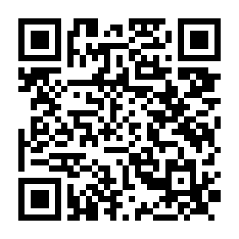

# Learn Italian: a free, open study pack

A small, free set of PDFs and a plan for English speakers learning Italian from zero to about A2.
It is built around five ideas and nothing else: **cognates, reading with audio, grammar only when you need it,
speaking early, and surrounding yourself with Italian.** Every resource it links to is free.

## Start in two minutes
1. Download or clone this repo: `git clone <this repo's URL>`
2. Open `dist/pdf/00-START-HERE.pdf`.
3. Do 30 minutes a day: 10 min reading with audio, 10 min speaking out loud, 10 min of real Italian (a podcast, video or TV).

You do not need to install anything to learn. The PDFs are already built.

## What is inside
| PDF (in `dist/pdf/`) | Step | What you get |
|---|---|---|
| `00-START-HERE.pdf` | Overview | The 5-step path and a 30-minute daily routine |
| `01-Cognates-and-Grammar-Lookup.pdf` | 1 and 3 | English-to-Italian word patterns, false friends, and a "when you're stuck on X" grammar table |
| `02-Read-with-Audio.pdf` | 2 | Free stories with audio, a method, a 4-week schedule |
| `03-Speak-Now.pdf` | 4 | 14 key phrases, a kit for starting conversations, 8 real-life scenarios (café, flat hunting, university, bureaucracy...), short writing tasks |
| `04-Italian-Home.pdf` | 5 | A small set of free podcasts, videos and TV to repeat, with a weekly rhythm |
| `05-Everyday-Basics.pdf` | 4 | Numbers, time, days, months, weather, greetings, places, emergencies |
| `06-200-Phrases.pdf` | 4 | 200 essential phrases for living and studying in Italy, in 17 themes |
| `07-Topic-Words.pdf` | 4 | Colours, family, jobs, school, the classroom, countries and nationalities, job hunting, workplaces and hobbies, word by word, one topic per page |

## Free means free
Everything linked is free to use. Some sites also sell apps or courses; they are marked "ignore" in the files and you never need them.
Links were opened and checked on the date recorded in each file in `content/resources/`. Links rot, so tell us if one breaks.

## The app (works on your phone, offline)
A small study app lives in `docs/` and is published with GitHub Pages: a daily 30-minute plan, flashcards with spaced repetition,
number/time/date drills, role-play scenarios, and a **Translate & log** screen: translate while you talk, then save the line (with the situation and any correction) to a conversation log that becomes flashcards. It installs to your home screen and works offline
after the first visit. Your progress stays on your device (Settings has a backup you can move to another device).

Run it locally: `python -m http.server 8000 --directory docs`, then open http://localhost:8000.

**Publish it (maintainer):** GitHub repo, Settings, Pages, "Deploy from a branch", branch `main`, folder `/docs`.
Rebuild the app after content changes with `python build/app.py` and commit `docs/`.
The app uses your portfolio's "Study Room at Dusk" design tokens (`app/styles.css`).

**About translation.** Translate uses your browser's on-device translator when it has one ready (desktop Chrome), otherwise the free MyMemory service, which sees the text you type
(5,000 characters a day, or 50,000 if you add your email in Settings; the email stays on your device). Machine translation can be wrong, so every logged line starts "unchecked" until you confirm it with a local or a source.

## Install it on your phone
The app works in any browser, but it is easier to keep on your home screen. Open **https://iamhassanab.github.io/learn-italian-free/** (or scan the code) and install it:



- **Android (Chrome):** tap **Install the app** on the Today screen (or the browser menu, then Install app).
- **iPhone and iPad (Safari):** tap Share, then **Add to Home Screen**. The installed app on iPhone and iPad keeps its own data, separate from Safari, so install first, then use it from the icon. To bring progress over, use Download backup in Safari and Restore from file in the installed app, or turn on sync.
- **Computer (Chrome or Edge):** the install icon in the address bar, or the Install button in Settings.

It installs from the website, so there is no app store and no cost. It works offline after the first visit.

## Optional: sync your progress across devices
Progress is stored on each device. To keep a phone and a laptop in step, the app can sync through **your own free Supabase project**
(plain browser JavaScript, no server of ours). The project address and key are stored **only on each device**, never in this repository or the website.
1. In your Supabase project open SQL Editor, paste `supabase/schema.sql`, and run it (it is safe to run again). It creates one table per kind of data (cards, days, conversation log, ratings, drill totals, preferences), each locked to its owner. If you used the older single-table version of sync, just run this too: the app copies your old data across the first time you sync.
2. Authentication, Sign In / Providers: turn **off** "Allow new users to sign up". Then Authentication, Users, Add user, and create your own email and password (auto-confirm).
3. In the app: More, Settings, "Sync across devices (optional)". Paste your project address and the **publishable** key (Project Settings, API Keys), then Save on this device and sign in.
   The app refuses secret and service_role keys.
4. For another device, tap "Copy setup link for another device" and open that link there (send it only to yourself). The link has the address and publishable key, never a password.
**About the key.** A publishable key is only an identifier. What protects your data is row-level security, the sign-in with your password, and sign-ups being off.
It cannot be hidden from your own browser, but it is not in the repo or the site, so nobody else sees it. If it ever leaks, create a new publishable key in the dashboard and disable the old one.
Sync works row by row: each device downloads what changed in the cloud, merges it in, and uploads only the rows it changed, so two devices can't overwrite each other's work. The newest review of each card wins, activity days are combined, and deleted log lines stay deleted. Only your study preferences (new cards per day, direction, chosen decks) follow you; voice, theme, hand and translator settings stay on each device. To move to a different Supabase project, run `supabase/schema.sql` there and enter its address and key in Settings: everything is uploaded to it. Details: `DATABASE-PLAN.md`.
Without any setup the sync section stays collapsed and the app works as before.

## Rebuild the PDFs (optional)
```
pip install -r requirements.txt
python build/all.py
```
Needs Python 3.9+. The build looks for Arial, Liberation Sans or DejaVu Sans; set `ITALIAN_FONT_DIR` to a folder with
`regular.ttf`, `bold.ttf` and `italic.ttf` if none is found. Checking links: `python build/linkcheck.py`.

## How the repo is organised
Content is split into small files so any one thing is easy to fix or replace:
`content/` (modules, one block per file; one file per link; fact-check ledger), `schema/` (what files may contain),
`build/` (checker, link checker, PDF and app builders), `app/` (web app source), `docs/` (built app for GitHub Pages), `plan/` (roadmap: one file per task; run `python build/plan.py`).
See [CONTRIBUTING.md](CONTRIBUTING.md) for how to fix, add or remove things.

## Roadmap
`python build/plan.py` prints the board. Next: more grammar rows and a pronunciation module.

## Credits and honest limits
- The five-step method follows Olly Richards' video "How I Would Learn Italian (if I could start over in 2026)" (StoryLearning).
  Method ideas also come from Joy of Languages and the Italy Made Easy mini-course. This project is not affiliated with any of them.
- We link to other people's work; we do not copy it. Sources for facts are recorded in `content/ledger/`.
- This is a study aid made by a learner, not a textbook. It can contain mistakes, and information about bureaucracy
  (permits, tax code, bank accounts) is general: always check official sources. Corrections are welcome.

## License
Content (the study material, PDFs and plan): [CC BY-SA 4.0](LICENSE-CONTENT.md). Code (`build/`, `schema/`, `.github/`): [MIT](LICENSE).
Contributions are accepted under the same licenses.
